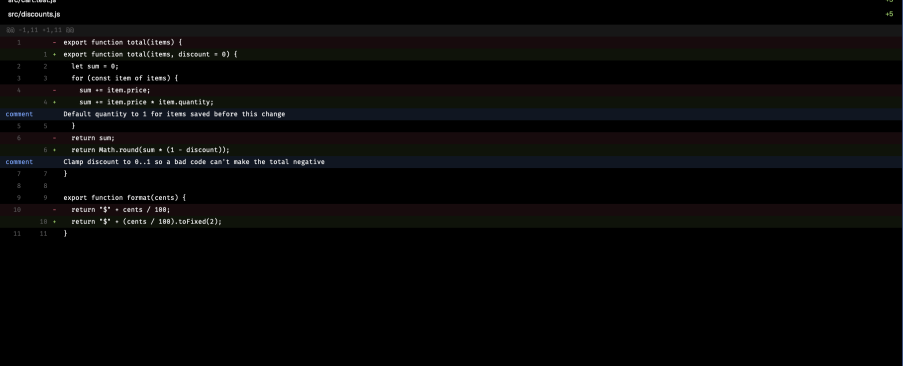

# Branch Review

A pane that shows the current branch's changes against its base, or the changes in commits you pick. Click a diff line to leave a comment on it, then send all your comments to a Claude Code session as one review message.

## What you see

- A pane to the right of the focused pane, opened with `ctrl-b shift-v`. It reviews the repo of the pane that was focused when you opened it.
- A header: "Review", the branch and its base (`feat/cart-discounts → main`), the comment count, and a Refresh button.
- Two scope chips: "Branch vs main" (the base's name) and "Uncommitted". Under them, the branch's commits, newest first: short hash in the accent color, subject, and age. At most 132px tall, then it scrolls.
- The changed files, with `+`/`−` counts and a count of comments on that file. At most 150px tall.
- The diff of the selected file in the terminal font, 20px rows: old line number, new line number, a `+`/`−` mark, the text. Added rows have a green tint, removed rows a red tint, hunk headers a raised background.
- Each comment as a row under its line: "comment" in the accent color, then the text, on an accent-tinted background.
- A comment bar: the picked line (`cart.js:6`) or "No line picked", a text box, and Save and Delete while a line is picked.
- A send row: "Send to", one chip per running Claude Code session (`t4 · space/tab`), and a "Send N" button.

## How it behaves

- "Branch vs main" diffs the merge-base of `HEAD` and the base against `HEAD`, so commits that landed on the base after the branch started don't show. The base is `origin/HEAD`, else the first of `origin/main`, `main`, `origin/master`, `master` that exists.
- "Uncommitted" diffs `HEAD` against the working tree. Untracked files aren't included.
- Click a commit to see only its diff. Click it again to go back to the whole branch. Shift-click another commit to see the range between the two.
- Click a file to show its diff. The first file opens by itself.
- Click a diff line to comment: the text box takes the keyboard, Enter or Save keeps the comment, Escape cancels. An empty comment, or Delete, removes it. Click a comment row to edit it.
- A comment belongs to the view it was made in, because line numbers in one commit's diff can differ from the branch's. Comments made in other views are counted under the diff, and they are sent too.
- Comments are saved per repo and branch, so they survive a reload.
- The send row lists sessions whose program reports `app: "claude-code"`. Sessions whose folder is inside the repo come first. The first one is picked unless you click another.
- Send pastes one message into that session with `hc send` and presses Enter. On success the sent comments are cleared and a toast says how many went where. On failure the error shows above the comment bar and the comments stay.
- The message lists every comment sorted by file and line: `path:line`, the quoted line, and the comment. A removed line says "(removed line, old numbering)".
- It refreshes every 15 seconds and on Refresh.

## Built from

- Two mods. `mods/branch-review/` is the pane: `main.js`, and `review.js` with the diff parsing and message text (no `herdr` imports, so node can test it). `mods/branch-review-open/` is a 1×1 popup that runs `pane.split {direction: "right", mod: "branch-review", props: {folder, on}}` with the focused pane's folder and machine, then closes itself, because a key can't pass props.
- `keys.json` binds `ctrl-b shift-v` to `mod.open:branch-review-open` in `global` and `terminal`.
- The pane runs `git` (`rev-parse`, `branch`, `symbolic-ref`, `merge-base`, `log`, `diff`) in the repo, with `--no-optional-locks` so it never writes under `.git`. It reads sessions from `agents()` and `terminals()`, and sends with `hc(["send", address, text])`.
- The diff is a `v_virtual_list` with fixed 20px rows. Comment rows are rows in the same list.

## Watch out

- A virtual list's rows can't have `on_click`: rendering throws, and the list shows nothing with no error in `herdr-app status`. Use `on_item_click((key, cx) => …)` on the list, with the row index as the key.
- Herdr didn't reload the mod when its files changed through a symlinked mod folder. Reopen the pane after editing.
- The text box is one line, so a comment is one line.
- Each file's diff stops at 3,000 lines, and long lines are cut at 2,000 characters.
- `hc send` waits for a pause in the person's typing in the target terminal, then pastes.

## Done when

- `herdr-app check mods/branch-review` and `herdr-app check mods/branch-review-open` pass.
- `ctrl-b shift-v` in a repo on a branch opens the pane with the branch's commits and files, and the first file's diff with line numbers.
- Clicking a commit shows only that commit's files; shift-clicking a second shows the range.
- Clicking a line, typing, and pressing Enter adds a comment row under that line.
- Send puts the review message into the picked Claude Code session and clears the comments.
