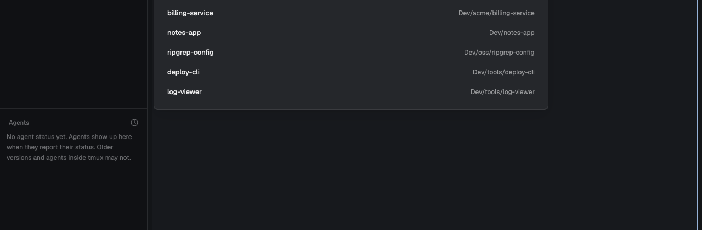

# Projects

A popup listing your git repos. Pick one to jump to its space, or to open a new space there.

## What you see

- A popup near the top of the window, 720px wide and 560px high, 40px from the top.
- A heading, "Projects", with a count on the right, and a filter box under it.
- Up to 12 rows: the repo's name, and its path on the right. Repos with an open space come first, with a dot.

## How it behaves

- Typing filters by name or path. Up and Down move, Enter opens, Escape closes, and a click opens a row.
- A repo with a space goes to that space. A space matches by its folder or its name, so two repos with one name both show as open.
- Any other repo gets a new space named after it, in that folder.
- If `scripts/dev-layout.sh` exists in your Herdr home and can run, it lays out the new space.

## Built from

- One mod, `mods/projects/`: `main.js`, `list.js`, `mod.json`, `projects.py` and `open-project.sh`. `mod.json` has `place: "none"` and the popup overlay, so nothing changes in your layout.
- `ROOTS` and `LAYOUT_SCRIPT` at the top of `main.js` are the customization points. `ROOTS` defaults to `~/Dev`, searched two levels down.
- The layout script gets `<pane> <terminal> <tab> <space> <folder>`.
- `keys.json` binds `ctrl-b o`. Change it if you use that key.

The mod runs programs (`python3`, `herdr-app`, `jq`, and your layout script if you have one) and reads folder names under `ROOTS`.

## Watch out

- `_ARCHIVE`, `node_modules`, `target` and `vendor` are skipped, in `projects.py`.
- Repos deeper than two levels aren't found.
- `jq` and `python3` must be on your PATH.

## Done when

- `herdr-app check mods/projects` passes.
- The popup lists your repos, open ones first.
- Enter on an open repo goes to its space, and on a closed one makes a space in that folder.
