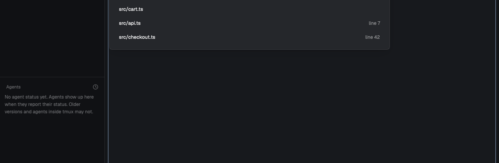

# Visible files

A popup listing the files named on the focused terminal, so a path an agent or a compiler just printed is one keypress from your editor.



## What you see

- A popup near the top of the window, 720px wide and 560px high, 40px from the top.
- A heading, "Visible files", with a count on the right, and a filter box under it.
- Up to 12 rows: the path as it appeared on screen, and "line 42" on the right when the text gave a line.

## How it behaves

- Typing filters. Up and Down move, Enter opens, Escape closes, and a click opens a row.
- A row counts only if the file exists, tried against the terminal's folder and then its git root. The newest mention comes first, and each file appears once.
- Enter opens the file in this tab's nvim, else this space's, if that nvim listens as below. Otherwise it opens in `$EDITOR` in a new pane to the right, at the line when there is one.

## Built from

- One mod, `mods/visible-files/`: `main.js`, `list.js`, `mod.json` and `visible-paths.py`. `mod.json` has `place: "none"` and the popup overlay, so nothing changes in your layout.
- `visible-paths.py` runs `hc read <terminal> --lines 200` and finds the paths.
- `keys.json` binds `ctrl-b ctrl-o`. Change it if you use that key.

The mod runs programs (`hc`, `git`, `python3`, `nvim`, your `$EDITOR`) and reads terminal text.

## Optional: open in a running nvim

Add this to your nvim config so it listens where the mod looks:

```lua
if vim.env.HC_TERMINAL_ID then
  local server = vim.fn.stdpath("state") .. "/herdr-" .. vim.env.HC_TERMINAL_ID .. ".sock"
  vim.fn.delete(server)
  pcall(vim.fn.serverstart, server)

  function _G.herdr_open(path, line)
    vim.cmd.edit(vim.fn.fnameescape(path))
    if line and line > 0 then
      pcall(vim.api.nvim_win_set_cursor, 0, { line, 0 })
    end
    return ""
  end
end
```

That version opens the file in nvim's current window, so a focused file tree gets replaced. Pick a better window there if you keep one open.

## Watch out

- It uses `~/.local/state/nvim`, so a custom `stdpath("state")` needs `server()` in `main.js` changed too.
- Local terminals only: a path on another machine won't be found here.
- `python3` must be on your PATH.

## Done when

- `herdr-app check mods/visible-files` passes.
- After `ls` or `git status` in a repo, the popup lists those files, and a path with `:12` opens at line 12.
- With no running nvim, Enter opens `$EDITOR` in a new pane.
